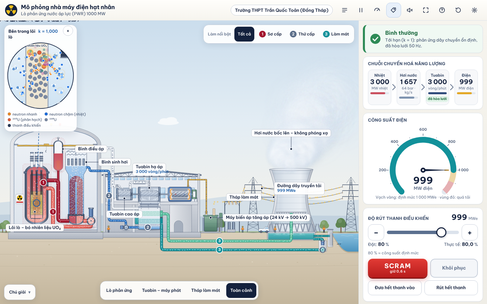
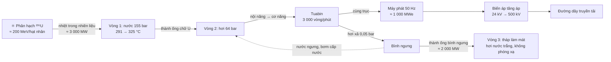

# Mô phỏng nhà máy điện hạt nhân PWR 1000 MW

[](https://github.com/harieedawwn/lo-hat-nhan-simulator/actions/workflows/deploy.yml)
[](LICENSE)
[](https://harieedawwn.github.io/lo-hat-nhan-simulator/)

**▶ Mở ngay: <https://harieedawwn.github.io/lo-hat-nhan-simulator/>**



Mô phỏng 2D tương tác, bằng tiếng Việt, về nhà máy điện hạt nhân lò nước áp lực (PWR) 1000 MWe, dành cho **Vật lí 12 – Kết nối tri thức**, chương IV “Vật lí hạt nhân” (phản ứng phân hạch, phản ứng dây chuyền, hệ số nhân neutron k) và Bài 24 “Công nghiệp hạt nhân”.
Học sinh tự rút/đưa thanh điều khiển, nhìn phản ứng dây chuyền ở mức hạt nhân, theo dõi ba vòng nước, tuabin – máy phát, thử SCRAM và thấy vì sao lò dừng rồi vẫn phải làm mát.

## Tính năng

- **Sơ đồ mặt cắt vẽ gốc (SVG)**: vỏ bọc lò, thùng lò, lõi lò, thanh điều khiển, bình điều áp, bình sinh hơi (ống chữ U), bơm vòng 1, nhà tuabin (cao áp, hạ áp, máy phát, bình ngưng), máy biến áp, trạm phân phối, đường dây truyền tải, tháp làm mát hyperbol, bể nước lạnh, cửa lấy nước sông/hồ.
- **Ba vòng nước tách biệt**: vòng 1 (sơ cấp, có phóng xạ, ① đỏ), vòng 2 (thứ cấp, ② hơi xám/nước xanh dương), vòng 3 (làm mát, ③ xanh lơ/xanh ngọc). Chỉ nhiệt đi qua thành ống chữ U và thành ống bình ngưng. Mỗi vòng có số, kiểu nét và nút “Làm nổi bật vòng 1/2/3”.
- **Mọi chuyển động do mô hình điều khiển**: hạt dòng chảy đúng chiều và đúng lưu lượng, bọt sôi chỉ ở phía vòng 2, thanh điều khiển rơi khi SCRAM, tuabin tăng tốc – hòa lưới – tự do quay chậm dần, xung điện theo P<sub>điện</sub>, đám hơi trắng (không phóng xạ) theo nhiệt thải.
- **Kính lúp “Bên trong lõi lò”**: neutron nhanh bị nước làm chậm thành neutron nhiệt, ²³⁵U phân hạch thành hai mảnh và 2–3 neutron, ²³⁸U gần như thụ động, thanh điều khiển hấp thụ neutron.
- **Bảng điều khiển**: trạng thái (Bình thường / Cảnh báo / Quá nhiệt / SCRAM), chuỗi Nhiệt → Hơi → Tuabin → Điện, đồng hồ công suất điện, thanh điều khiển, nhiệt kế 40–350 °C kèm dải phóng đại 280–350 °C, hệ số k, tách phân hạch/dư nhiệt, cân bằng năng lượng, biểu đồ 60 giây và **Góc tính toán**.
- **Thẻ thông tin** cho 28 bộ phận (chạm để mở): chức năng, số liệu thật, thuộc vòng nào, có phóng xạ hay không, “Bạn có biết?”.
- **Âm thanh thủ tục** (Web Audio, không tải tệp), hướng dẫn nhanh 4 bước, phím tắt cho giáo viên, chế độ nhãn ẩn để hỏi bài.
- **Chạy tốt trên điện thoại**, kể cả trong trình duyệt của Zalo; có chế độ toàn màn hình hoặc “bao phủ” khi iPhone không hỗ trợ.

## Cách dùng

**Điện thoại.** Mở liên kết (Zalo, Safari, Chrome đều được). Ở màn hình khởi động chọn *Xem toàn màn hình* hoặc *Xem bình thường*. Kéo thanh trượt “Độ rút thanh điều khiển” trong bảng ở dưới; kéo tay cầm của bảng lên để xem toàn bộ số liệu. Chụm hai ngón để phóng to sơ đồ, chạm vào bộ phận để xem thẻ thông tin. Xoay ngang để có sơ đồ rộng hơn; bảng điều khiển nằm trong ngăn kéo bên phải.

**Máy tính, máy tính bảng.** Bảng điều khiển nằm bên phải (hoặc phía dưới khi xoay dọc). Phím tắt: `Space` tạm dừng · `←`/`→` thanh điều khiển · `L` nhãn · `F` toàn màn hình · `1`/`2`/`3` làm nổi bật vòng · `0` toàn cảnh.

**Mở trong Zalo.** Mô phỏng chạy ngay trong trình duyệt của Zalo. Muốn toàn màn hình thật sự: Android bấm “Mở bằng trình duyệt”; iPhone chạm “⋯” ở góc trên bên phải → “Mở bằng trình duyệt” (hoặc “Sao chép liên kết”). Trong Safari có thể “Thêm vào Màn hình chính” để mở như ứng dụng toàn màn hình.

## Vật lí



| Đại lượng | Giá trị định mức |
|---|---|
| Công suất nhiệt P<sub>nhiệt</sub> | 3 000 MW |
| Công suất điện P<sub>điện</sub> | ≈ 1 000 MW (η ≈ 33 %) |
| Nhiệt thải P<sub>thải</sub> = P<sub>nhiệt</sub> − P<sub>điện</sub> | ≈ 2 000 MW |
| Vòng 1 | 155 bar; nhánh nóng ≈ 325 °C, nhánh lạnh ≈ 291 °C; điểm sôi ở 155 bar ≈ 345 °C |
| Vòng 2 | hơi bão hoà ≈ 64 bar, ≈ 280 °C, ≈ 1 650 kg/s; bình ngưng ≈ 0,05 bar |
| Vòng 3 | ΔT ≈ 10 °C qua bình ngưng, ≈ 48 000 kg/s |
| Tuabin – máy phát | 3 000 vòng/phút (n = 60·f/p, f = 50 Hz, p = 1) |
| Máy biến áp | ≈ 24 kV → 220–500 kV (P<sub>hao phí</sub> = P²R/U²) |
| Phản ứng ví dụ | ²³⁵U + n → ¹⁴¹Ba + ⁹²Kr + 3n (A: 236 = 141 + 92 + 3; Z: 92 = 56 + 36) |
| Dư nhiệt sau dừng lò | ≈ 6–7 % ngay sau SCRAM, ≈ 3 % sau 1 phút, ≈ 1–2 % sau 1 giờ |
| Tiêu thụ ²³⁵U ở 3 000 MWt | ≈ 3,2 kg/ngày (N ≈ 9,4·10¹⁹ phân hạch/s) |
| Khối lượng chuyển thành năng lượng (E = mc²) | ≈ 2,9 g/ngày |
| Than tương đương (29,3 MJ/kg) | ≈ 8 800 tấn/ngày |

Mô hình không thể “nổ như bom”: nhiên liệu chỉ làm giàu 3–5 % ²³⁵U.

## Giả thiết của mô hình (trung thực)

Đây là mô hình dạy học đơn giản hoá, bước cố định Δt = 0,05 s, thời gian được nén.

- **Công suất tỉ lệ độ rút thanh**: p<sub>f</sub>* = w/80 (80 % ≈ 100 % công suất). Thực tế công suất ổn định do tổng phản ứng của hệ quyết định (thanh điều khiển, axit boric, phản hồi nhiệt độ âm).
- Thanh dịch chuyển 8 %/s (thực tế rất chậm), có bước rời rạc 0,5 %. SCRAM: thanh rơi tự do hết trong 2 s.
- p<sub>f</sub> bám p<sub>f</sub>* với hằng số thời gian 3 s (tăng) / 2 s (giảm). Sau SCRAM p<sub>f</sub> tụt nhanh còn ≈ 3 %, rồi tắt dần (τ = 15 s).
- Nhiệt phân rã p<sub>d</sub> → 6,5 % p<sub>f</sub> (τ = 60 s); sau dừng lò theo Way–Wigner P/P₀ ∝ t<sup>−0,2</sup> với thời gian nén ×10. Tổng nhiệt p = 0,935·p<sub>f</sub> + p<sub>d</sub>.
- Hệ số k suy ra từ tốc độ đổi của p<sub>f</sub> (đúng bằng 1,000 khi ổn định).
- T<sub>nóng</sub> = 291 + 33·p, T<sub>lạnh</sub> = 291 − p (°C), trễ ≈ 6 s; áp suất vòng 1 ≈ 155 bar; lưu lượng vòng 1 không đổi (bơm luôn chạy).
- Tuabin tăng tốc 12 s rồi hòa lưới; sau hòa lưới giữ 3 000 vòng/phút; P<sub>điện</sub> = 0,333·P<sub>nhiệt</sub> (trễ 2–3 s). Ngắt tuabin → chạy đà 25 s (thực tế hàng chục phút). Hơi dư sau ngắt được xả thẳng xuống bình ngưng.
- Bảo vệ: “Cảnh báo” khi p > 1,03 hoặc T<sub>nóng</sub> > 325,5 °C; “Quá nhiệt” khi p > 1,10 hoặc T<sub>nóng</sub> > 327,5 °C → đếm ngược **5 s** rồi tự SCRAM; p ≥ 1,18 tắt ngay. Thực tế hệ thống bảo vệ tác động trong chưa đầy 1 giây – đếm ngược chỉ để dạy học.
- “Khôi phục” chỉ khi p<sub>f</sub> < 1 % và T<sub>nóng</sub> gần 291 °C; thanh vẫn ở 0 %.
- Màu lõi lò là bản đồ nhiệt minh hoạ (lõi thật không phát sáng đỏ).

## Gợi ý hoạt động cho giáo viên

1. **Ba vòng nước không bao giờ trộn lẫn** – bấm “Làm nổi bật” từng vòng, tìm hai ranh giới truyền nhiệt, ẩn nhãn để hỏi bài.
2. **SCRAM và nhiệt phân rã** – bấm SCRAM ở 100 %: k < 1, p<sub>f</sub> → 0 nhưng tổng nhiệt còn ≈ 6–7 %; vì sao bơm và làm mát vẫn chạy?
3. **Tính lượng ²³⁵U tiêu thụ** – tự tính N = P/E₁ và m = N·t·A/N<sub>A</sub>, so với “Góc tính toán”.

## Âm thanh

Hoàn toàn tạo sinh bằng Web Audio (dao động, nhiễu lọc, hồi âm tạo từ nhiễu), không tải tệp: tiếng phòng lò và bơm vòng 1; tiếng bước của cơ cấu thanh điều khiển, nhả và va chạm khi SCRAM; hơi rít, ù và sôi theo lưu lượng hơi; tuabin rít/gầm theo vòng/phút; máy phát ù 100/150/200 Hz theo P<sub>điện</sub>; tiếng đóng/cắt máy cắt khi hòa lưới và ngắt; mưa của tháp làm mát và gió nhẹ; chuông cảnh báo (nhẹ cho Cảnh báo, gấp cho Quá nhiệt, còi riêng cho SCRAM rồi nhắc nhỏ đến khi Khôi phục). Vùng đang phóng to nghe to và rõ hơn. Có bộ nén và hạn biên tổng, tạm dừng khi tab ẩn. Trên iPhone: tắt chế độ im lặng nếu không nghe tiếng.

## Công nghệ

Vite + JavaScript ES module (không framework) · một SVG vẽ tay + lớp Canvas 2D cho hạt, bọt, giọt, đám hơi · mô hình thuần (`src/sim`) kiểm thử bằng Vitest · Web Audio · phông Be Vietnam Pro tự lưu trữ (woff2) · GitHub Actions + GitHub Pages. JS ≈ 50 KB gzip.

## Phát triển cục bộ

```bash
npm install
npm run dev      # chạy thử tại http://localhost:5173
npm test         # kiểm thử mô hình và các phép tính
npm run build    # bản dựng vào dist/
npm run build && npm run e2e   # kiểm thử Playwright trên bản dựng (hoặc: node e2e/run.mjs <url>)
```

## Cấu trúc

```
src/sim/        model.js (mô hình thuần, bước cố định) · calc.js (Góc tính toán) · format.js
src/render/     geometry.js (ống, đường dòng) · plant_*.js (SVG) · flows.js (hạt Canvas) · lens.js
                stage.js · camera.js · labels.js · scene.js
src/ui/         panel.js · modals.js · parts.js (thẻ thông tin) · inapp.js · quality.js · storage.js
src/audio.js    đồ thị Web Audio
tests/          Vitest
e2e/            Playwright: kiểm thử, chụp ảnh, tạo ảnh OG/icon
.github/workflows/deploy.yml
```

## Ghi công

Trường THPT Trần Quốc Toản (Đồng Tháp). Toàn bộ hình vẽ là tác phẩm gốc, không sao chép từ ảnh stock. Giấy phép MIT.

---

**English summary.** An interactive 2D simulator (Vietnamese UI) of a 1000 MWe pressurized water reactor plant for Grade 12 physics: control-rod driven chain reaction with a particle-level core lens, three strictly separate water loops, turbine/generator synchronization at 3000 rpm, SCRAM with decay heat, live calculations (fission rate, U-235 burn-up, E = mc², coal equivalent), procedural Web Audio, and robust behaviour inside Zalo/in-app WebViews. Built with Vite and vanilla JS; the model is a pure, deterministic, unit-tested module. Live: https://harieedawwn.github.io/lo-hat-nhan-simulator/
